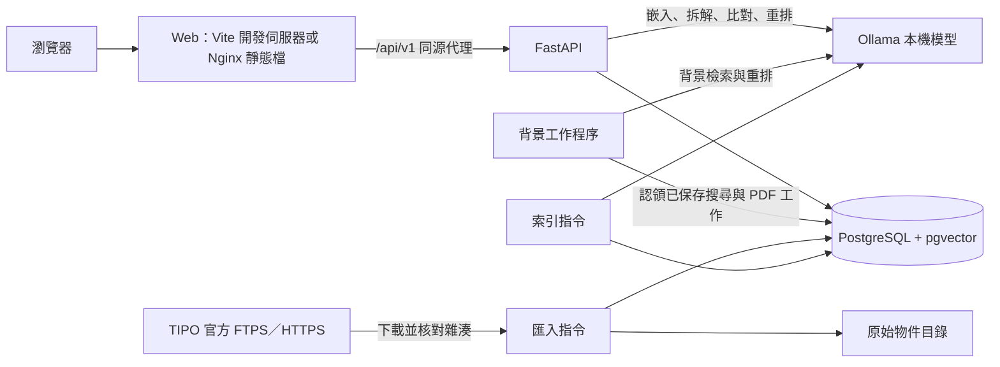

# 系統架構

PatentScope AI 由 React 前端、FastAPI、背景工作程序、PostgreSQL 及部署者自管的 Ollama 模型服務組成。Compose 管理應用程式及資料庫，Ollama 可在受控主機獨立執行。實作規格見 [AGENTS.md](../AGENTS.md)。

## 模組

| 路徑 | 職責 |
| --- | --- |
| `apps/web` | React、TypeScript、Tailwind。單頁研究工作台，所有資料來自 API。`e2e/` 是 Playwright TypeScript 測試。 |
| `services/api` | REST 路由、Pydantic 結構、帳號驗證與統一錯誤格式。 |
| `services/ingestion` | TIPO 下載、XML 解析、原始物件保存、批次匯入與回溯驗證。 |
| `services/retrieval` | 繁中斷詞、詞彙與向量索引、RRF 融合、重排、技術特徵與證據處理。 |
| `database/migrations` | Alembic 遷移。資料表見 [資料庫設計](DATABASE.md)。 |
| `scripts` | 冒煙測試、評估與測試語料種子。 |
| `evaluation` | 檢索評估的查詢與待人工複核的候選池。 |

## 離線匯入

1. `services.ingestion.download` 以驗證憑證的 FTPS 取得期別索引與個案 XML。
2. `import_issue` 把原始檔依 SHA-256 存入物件目錄，解析後在單一交易寫入申請案、文件版本、請求項、段落與來源關聯。相同輸入重跑會重用既有批次。解析失敗的檔案隔離並保留錯誤。
3. `verify_document` 從資料庫連回原始檔重新解析，逐項比對請求項與段落。
4. `index_lexical` 與 `index_semantic` 為尚未處理的文件版本建立索引，可重複執行。

匯入與索引由操作員啟動。可使用 `run_pipeline` 記錄匯入、詞彙與向量階段，研究工作台的管理員可以唯讀監控狀態。[匯入操作](SETUP.md#官方匯入與索引監控)

## 線上檢索

1. `POST /queries/analyze` 用本機模型草擬技術特徵，使用者可以編輯。
2. `POST /patents/search/hybrid` 以原始查詢和已確認的特徵詞分別跑詞彙與向量檢索，各取前 100 筆，以 RRF（k=60）融合，再依公開號與文件階段去重。可選擇用本機模型重排前幾筆，原始融合名次會保留。
3. `POST /patents/{id}/compare` 為每項特徵在同一文件版本找原文。字詞找不到片段時可用同版本向量索引候選；引文由伺服器依原文位置擷取並核對。
4. 登入後，「搜尋並保存」與私人 PDF 由 PostgreSQL 持久工作佇列處理，前端輪詢進度。預覽搜尋與技術比對仍透過同步 API。保存的搜尋包含候選排行、模型設定與索引涵蓋資訊。

使用者可另外下載自己的研究資料 JSON，內容涵蓋已保存的專案、候選、比對、收藏與 Session 訊息。[API 契約](API.md)

## 資料邊界

- 公開專利資料：API 只回傳來源為正式資料集且解析成功的文件。匯入工作進度限管理員查閱。
- 私人研究資料：專案、搜尋、收藏、Session。每次查詢以帳號 UUID 限定，跨帳號存取回傳 404。
- 模型服務：查詢文字和被比對的專利原文會送到設定的 Ollama 位址。處理未公開構想前，部署者須把模型服務限制在受控的網路內。

## 部署

- 開發：`docker-compose.yml`，含 Vite 開發伺服器與本機連接埠。
- 靜態部署：加上 `docker-compose.deploy.yml`，由 Nginx 提供編譯後的前端、同源 API、內容安全政策與入口速率限制，只有 Web 綁定回環位址。
- HTTPS 部署：再加上 `docker-compose.tls.yml`，以部署者提供的憑證開啟 HTTPS。
- 測試：加上 `docker-compose.test.yml`，使用獨立資料庫 `patentscope_test`。

HTTPS、速率限制及備份還原已有隔離環境驗收。外部網域、代理拓樸、憑證續期與正式環境復原需在目標主機驗證。[環境設定](SETUP.md)

## 目前沒有的部分

- 官方資料的自動更新排程。
- 結構化日誌與操作稽核紀錄。
- 語料快照版本化：保存的搜尋保留當時的候選與分數，但無法以舊語料重跑。
- 經人工標註的檢索品質評估，見 [檢索評估](EVALUATION.md)。
