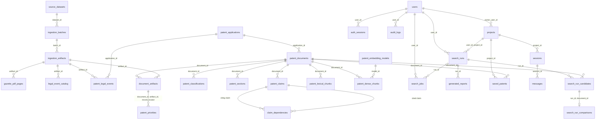

# 資料庫設計

PostgreSQL 16 搭配 pgvector 0.8.2。結構由 `database/migrations/versions/` 的 Alembic 遷移建立，此整合分支單一 head 為 `0023_patent_priorities`。

`audit_logs` 保存帳號 UUID、操作、結果、資源類型、可選的資源 UUID 及時間。API 角色可讀取與新增，無更新或刪除權限。刪除帳號時由外鍵清理歷程。

`legal_event_catalog` 保留已驗證發明、新型及設計異動的申請號、證書號、日期、原始檔及記錄位置。專利匯入時以申請號索引配對，已連結的詳情仍從 `patent_legal_events` 讀取。API 角色無異動暫存表的讀寫權限。

`0020_gazette_pdf_pages` 依原檔及頁碼保存 PDF 文字層，以 `(artifact_id, page_number)` 為主鍵。每頁上限 20,000 字元，允許空文字層。API 角色僅可讀。查閱時需依 `document_artifacts` 核對該版本與 PDF SHA-256 的關聯。降版移除衍生文字頁，原始公報與既有專利版本可供重新擷取。

`0021_gazette_pdf_search` 以現有繁中雙字詞分詞建立 GIN，升版會回填既有擷取頁。新匯入 PDF 同步建立頁面詞彙索引。降版移除衍生索引欄位，保留 PDF 文字層。

`0022_legal_event_grant_types` 擴充證書號約束，並接受具有官方尾碼的衍生設計申請號。新型及設計事件須與同一案的公告證書號相符才會連結。降版前若有任何新型或設計事件，遷移會停止並保留資料。

主鍵多為 UUID（`gen_random_uuid()`），時間欄位為 `timestamptz`，只知道日期時用 `date`。

## 資料表關係

## 來源與匯入（`0002_ingestion`）

| 資料表 | 用途 | 重要約束 |
| --- | --- | --- |
| `source_datasets` | 官方資料集、提供機關、授權網址、查核時間。`is_demo` 標示測試資料。 | `dataset_key` 唯一。 |
| `ingestion_batches` | 一次匯入。`checksum` 是輸入清單的雜湊，`counts_jsonb` 保存筆數與下載失敗。 | `(dataset_id, batch_key, checksum, parser_version)` 唯一，相同輸入重跑會重用既有批次。狀態限 `processing`、`complete`、`partial`、`failed`。 |
| `ingestion_artifacts` | 每個原始檔的來源位置、SHA-256、物件鍵、大小與解析狀態。解析失敗的檔案以 `quarantined` 保留並記錄錯誤。 | `(batch_id, source_locator)` 唯一，雜湊須為 64 位十六進位。 |
| `document_artifacts` | 文件版本與原始檔的多對多關聯，`record_locator` 是檔內位置。 | 三欄複合主鍵。 |

## 專利文件（`0002_ingestion`）

| 資料表 | 用途 | 重要約束 |
| --- | --- | --- |
| `patent_applications` | 申請案。 | `(jurisdiction, application_no)` 唯一。 |
| `patent_documents` | 公開或公告的文件版本。`metadata_jsonb` 保存申請人、發明人與 `content_scope`（`fulltext`、`claims_only`、`metadata_and_abstract`）。 | `(jurisdiction, document_stage, publication_no, kind_code, source_hash, parser_version)` 唯一。來源內容或解析器改變會產生新版本，舊版本保留。 |
| `patent_priorities` | 官方公告的版次優先權及其原始 XML 定位。 | 同一版本以國別原文、優先權號、日期去重。 |
| `patent_classifications` | IPC 與來源提供的分類版次。 | `(document_id, scheme, code, version)` 唯一。 |
| `patent_sections` | 說明書段落原文與 XPath、原始檔雜湊。 | `(document_id, section_type, ordinal)` 唯一。 |
| `patent_claims` | 請求項原文、編號、是否獨立項與來源定位。 | `(document_id, claim_number)` 唯一。 |
| `claim_dependencies` | 同版本的請求項原文援引。 | `(document_id, child_number, parent_number)` 唯一。 |
| `patent_legal_events` | `0015_legal_events` 保存已核對的異動公報事件。 | 申請案與原始檔外鍵，`(artifact_id, record_locator)` 唯一。消滅公告必須有明確生效日，更正事件只保存已提供的卷期。 |

同一申請案的公開版與公告版是不同的 `patent_documents` 列，共用 `application_id`。同一公開號也可以同時有書目版與全文版。

## 檢索索引（`0003_lexical`、`0004_semantic`）

| 資料表 | 用途 |
| --- | --- |
| `patent_lexical_chunks` | 依欄位與序號保存斷詞結果。`terms` 是由 `tokens` 產生的 `tsvector` 欄位，有 GIN 索引 `ix_patent_lexical_terms`。斷詞由應用程式完成（`han-bigram-v1`），PostgreSQL 的 `simple` 設定只負責切空白。 |
| `patent_embedding_models` | 向量模型的供應者、名稱、摘要與處理流程。維度固定為 1,024。 |
| `patent_dense_chunks` | 每個模型、文件、欄位、片段的向量與字元範圍。 |

`patent_dense_chunks` 使用精確的向量距離排序。現有規模量測涵蓋固定 117 版本的 1,624 個向量，以及擴充 518 版本的 3,164 個向量。何時需要近似最近鄰索引仍待更大語料的量測。[檢索效能基準](EVALUATION.md#2026-11-26-擴充語料與併發量測)

## 帳號與研究資料

| 資料表 | 遷移 | 用途 | 重要約束 |
| --- | --- | --- | --- |
| `users` | `0005` | 電子郵件、scrypt 鹽與雜湊。 | `email` 唯一。 |
| `auth_sessions` | `0005` | Bearer token 的 SHA-256 與到期時間。 | 主鍵為 `token_hash`。 |
| `login_failures` | `0010` | 登入失敗的電子郵件摘要與時間，用於節流。 | 索引 `(email_hash, failed_at)`。 |
| `projects` | `0006` | 研究專案。 | `(owner_user_id, id)` 唯一，供複合外鍵使用。名稱 1–120 字。 |
| `search_runs` | `0005`、`0006` | 保存的搜尋請求與設定。 | 複合外鍵 `(user_id, project_id)` 指向 `projects (owner_user_id, id)`，資料庫層拒絕把搜尋歸到別人的專案。 |
| `search_run_candidates` | `0005` | 搜尋當下的候選順位與分數快照。 | 主鍵 `(run_id, position)`，`(run_id, document_id)` 唯一，隨搜尋級聯刪除。 |
| `search_run_comparisons` | `0005` | 候選的技術特徵比對與引文。 | 外鍵指向候選，級聯刪除。 |
| `saved_patents` | `0007` | 專案內收藏的文件版本與筆記。 | 主鍵 `(project_id, document_id)`，筆記上限 4,000 字。 |
| `sessions`、`messages` | `0008`、`0009` | AI 拆解的 Session 與訊息。 | 訊息隨 Session 級聯刪除。使用者訊息須為 JSON 字串，助理訊息須為 JSON 物件。 |

私人資料的查詢都以帳號 UUID 限定。帳號刪除在單一交易內清除該帳號的搜尋、Session、收藏、專案、登入憑證與登入失敗紀錄。

## 遷移與回復

- `0002`、`0005`、`0006`、`0007`、`0008` 的降版會刻意丟出錯誤，因為降版會捨棄已匯入的專利或私人研究資料。要回復這些遷移需先備份，再另行決定處理方式。
- 後續遷移有個別 `downgrade()`，適用條件請查閱各遷移。`0013`、`0018` 等降版會移除對應的報告或稽核資料表，正式資料回復須使用經核對的備份。[備份及還原](SETUP.md#原始-xml-持久保存備份及還原)
- 驗收方式見 [測試文件](TESTING.md#postgresql-與-api-整合)。

## 與 AGENTS.md 資料模型的差異

相較 [AGENTS.md](../AGENTS.md) 第 5 節的規劃，目前資料存放方式如下。

- 申請人與發明人存於 `patent_documents.metadata_jsonb`。`patent_priorities` 以文件版本保存官方公告的國別原文、優先權號及日期，申請案關係由文件回溯。同一版本的相同國別、號碼與日期只保存一次。資料透過複合外鍵引用 `document_artifacts`，保留優先權節點的原始序位。`0023_patent_priorities` 可在空表時降版，有資料時會停止。
- `claim_dependencies` 保存原文明示的同版本援引。`patent_legal_events` 連結已核對的消滅及更正公告，涵蓋範圍見 [官方資料來源](DATA_SOURCES.md#專利權異動公報)。
- 原始文件透過 `document_artifacts` 關聯 `ingestion_artifacts` 與檔內位置。公報 PDF 文字以原件及頁碼保存。
- 技術特徵、比對判定與引文分別存於 `search_runs.request` 和 `search_run_comparisons.result` 的 JSONB。保存的搜尋保留候選排行與語料涵蓋資訊，重現舊索引所需的版本化語料快照尚未建立。
- 私人 PDF 由 `generated_reports` 工作非同步產生並暫存，保存期限見下方的背景工作說明。

## 查詢計畫

登入節流查詢在測試資料庫的 `EXPLAIN (ANALYZE, BUFFERS)` 使用 `ix_login_failures_recent` 的 Bitmap Index Scan，執行時間 0.057 ms（2026-11-10，空資料表）。詞彙、向量及公報 PDF 的查詢計畫與重現指令分別見 [檢索基線](EVALUATION.md#2026-11-26-postgresql-查詢計畫基線)及 [公報 PDF 基線](EVALUATION.md#2026-11-27-公報-pdf-詞彙查詢計畫)。
### 請求項原文援引

`0011_claim_dependencies` 新增 `claim_dependencies(document_id, child_number, parent_number)`。兩個複合外鍵都指向同一文件版本內的請求項，且被援引項號須小於援引項號，因此無循環。欄位名稱中的 `dependencies` 記錄可由正文核對的援引關係。來源 XML 的獨立項標記仍保留在 `patent_claims`。

遷移需連線至資料庫，會從已保存的正文分文件版本回填。新匯入在請求項寫入後，於同一交易保存援引。前綴用語未符合規則、範圍不完整或向後援引時，不建立該組關係。降版移除衍生表，會保留原始請求項；用 Compose 重新升版時會重建關係並補齊 API 讀取權限。
### 背景搜尋工作

`search_jobs` 保存狀態與活動期間的搜尋請求。部分唯一索引限制每個帳號一次只有一項等待中或執行中工作。工作程序以 `FOR UPDATE SKIP LOCKED` 認領佇列，提交交易後執行模型推論，避免長時間持有資料庫鎖。成功保存時，同一交易建立搜尋快照與候選並將工作標記為成功；取消後無法進入保存交易。

完成、失敗及取消會移除工作上的原始請求。刪除帳號或已保存搜尋，相關工作狀態也會一併清理。

`generated_reports` 透過搜尋紀錄外鍵繼承所有權。工作成功時才寫入最多 8 MiB 的 PDF，完成一小時後由工作程序清理。刪除搜尋紀錄會連帶刪除報告工作與檔案。若在暫存期間建立資料庫備份，備份可能也包含這些私人 PDF。
`ingestion_jobs` 保存操作員執行的官方期別、階段、狀態與計數。這項紀錄與 `ingestion_batches` 的來源雜湊和去重紀錄分開，重跑已有批次仍有自己的工作狀態。API 資料庫角色只有讀取權限；背景匯入使用現有離線角色寫入。

`archive_refresh_checkpoints` 保存排程完成的期別，主鍵為資料階段、民國年、匯入設定雜湊及卷期。只有該期的匯入流程成功後才新增進度，重啟會查詢同一組設定的既有紀錄。API 資料庫角色無權存取此表。
